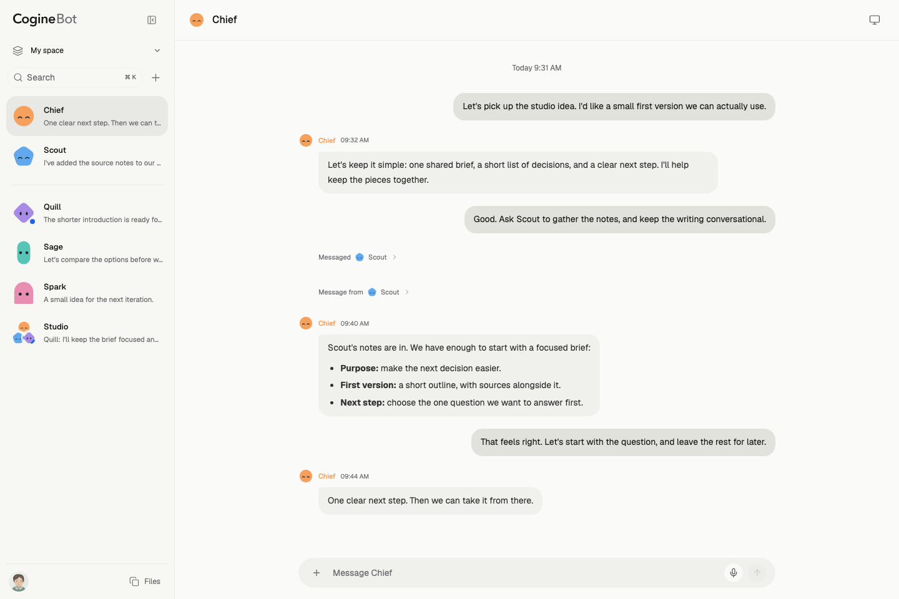
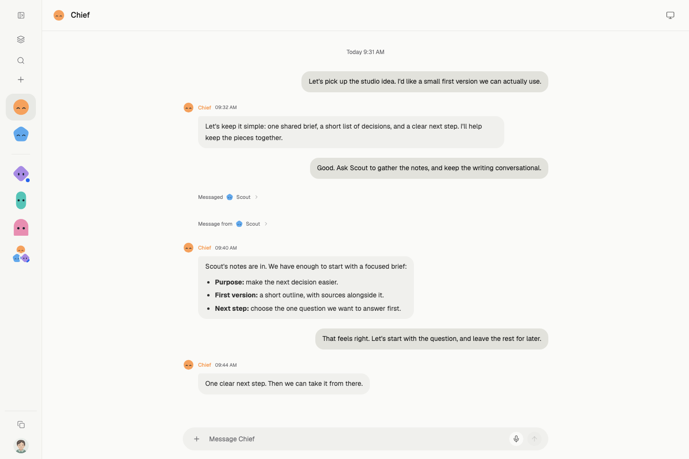
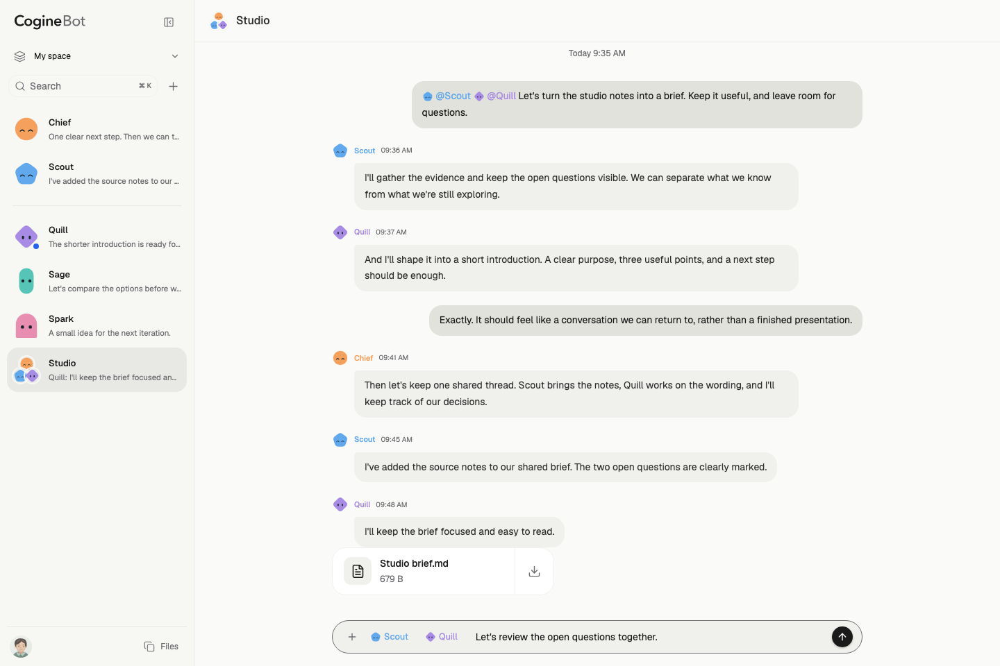
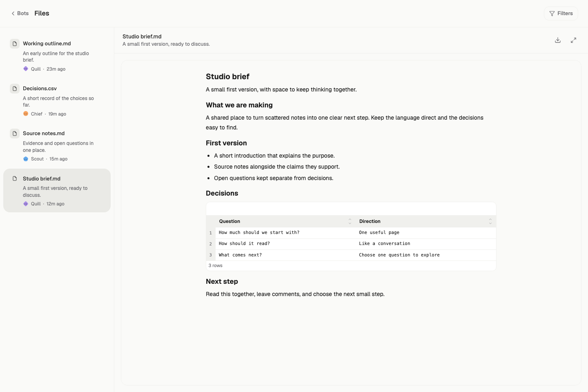
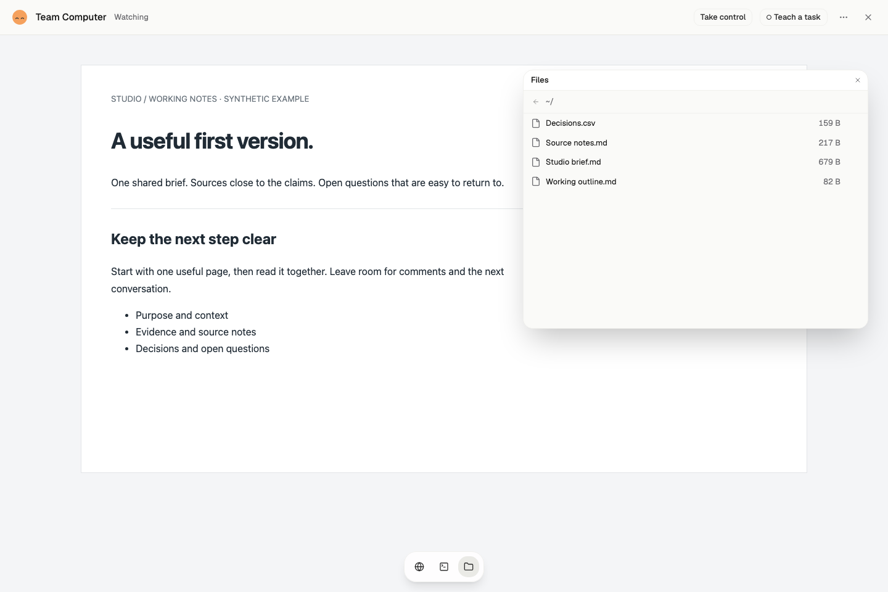

# CogineBot

[English](README.md) · **简体中文**

[下载](https://github.com/cogine-ai/CogineBot/releases/latest) · [自部署](docs/self-host.md#published-images-no-checkout) · [开发文档](docs/development.md) · [参与贡献](CONTRIBUTING.md)

CogineBot 是从 [Rakazo](https://github.com/elie222/rakazo) fork 的开源 AI Bot 应用，支持自部署、持续对话、群聊、Bot 间通信、文件和电脑操作。可以自行选择模型，通过网页或桌面客户端使用。

## 为什么 fork

我们是 Rakazo 的第一批用户。感谢作者将这个项目开源，让我们能在此基础上继续开发。

Personal Agent 还处在早期，大家对它应该是什么样、怎么做，都有很多不同的想法。我们也有自己的审美和产品方向，想通过 CogineBot 这个 fork 继续探索。

项目由 [cogine-ai](https://github.com/cogine-ai) 独立维护。目前已调整聊天时间线、侧边栏、群聊、头像、文件和电脑接管交互，具体改动见[适配记录](docs/upstream-adaptations.md)。我们也会继续关注上游，评估并合入适合的改动。



## 功能

- Bot 的对话历史、记忆和例行任务。
- 多 Bot 群聊、@ 提及和 Bot 间通信。
- 文件附件、预览、版本历史和下载。
- 通过 Bot 的电脑使用浏览器、终端和文件。默认先观看，点击 **Take control** 接管，点击 **I'm done** 归还。
- 可配置模型、应用连接和电脑提供方。

可选服务需要在自己的实例中配置，详见[自部署文档](docs/self-host.md)。

<details>
<summary>更多截图</summary>

### 压缩侧边栏



### 群聊



### 文件



### 电脑



</details>

## 安装

### 桌面端

在 [GitHub Releases](https://github.com/cogine-ai/CogineBot/releases/latest) 下载安装包并查看校验值。

| 平台 | 安装包 | 签名情况 |
| --- | --- | --- |
| macOS，Apple 芯片与 Intel | Universal `.dmg` / `.zip` | 已签名并公证 |
| Windows x64 | `.exe` 安装器 | 当前未签名；Windows 可能提示未知发行者 |
| Linux x64 | `.AppImage` | 随包提供校验值和构建来源证明 |

选择 **This computer**，使用 Docker Engine 26+ 和 Compose 在本机运行实例；或选择 **Existing instance**，连接已经部署的服务器。详见[桌面发行说明](docs/desktop-release.md)。

仓库也包含 Expo 移动客户端源码。目前尚无 CogineBot 自有移动发行版，也不提供托管服务。

### 自部署

按照 [Docker Compose 安装指南](docs/self-host.md#published-images-no-checkout)部署。指南包含配置、可选提供方、备份和更新说明。网页和桌面客户端可以连接同一个实例。

### 源码开发

使用 Node.js 24 和 pnpm 9.15.0。Node 支持范围见 [package.json](package.json)。

```sh
git clone https://github.com/cogine-ai/CogineBot.git
cd CogineBot
node scripts/check-repository.mjs
```

这条命令检查仓库文档和工作流元数据。安装依赖、运行测试及启动应用的方法见[开发文档](docs/development.md)。

当前检查结果见 [GitHub Actions](https://github.com/cogine-ai/CogineBot/actions/workflows/repository-ci.yml)。[改造前验证基线](docs/preparation-baseline.md)保留初期检查记录；[Agent 验证文档](docs/agent-verification.md)说明测试工具及覆盖范围。

## 近期计划

- **连接器：** 完善应用连接和已连接账号的管理。
- **iOS 客户端：** 先通过 TestFlight 测试自部署连接与日常使用，再准备 App Store 上架。

## 参与贡献

欢迎提交 Issue 和 Pull Request。较大的改动请先开 Issue 讨论，确定范围后再动手。

- [报告 Bug](https://github.com/cogine-ai/CogineBot/issues/new?template=bug.yml)：附上版本和复现步骤。
- [功能建议](https://github.com/cogine-ai/CogineBot/issues/new?template=feature-request.yml)：说明使用场景，也可以在这里提出想连接的应用。
- [安装求助](https://github.com/cogine-ai/CogineBot/issues/new?template=self-host.yml)：桌面端、服务器或源码安装相关问题。

开发与审查约定见 [CONTRIBUTING.md](CONTRIBUTING.md)。安全漏洞请通过[私密渠道](SECURITY.md)报告。

## 上游与许可证

[UPSTREAM.md](UPSTREAM.md) 记录源码版本和集成策略。内部 `@rakazo/*` 包名、协议和存储标识保留，以维持兼容。原始 [README.upstream.md](README.upstream.md) 原样保留。仓库检查及发布工作流见[自动化文档](docs/automation.md)。

CogineBot 保留 Rakazo 从 [`794a76da6eb0a73532a89cf57d2f202ef9b6b6c8`](https://github.com/elie222/rakazo/commit/794a76da6eb0a73532a89cf57d2f202ef9b6b6c8) 开始的历史、[Apache-2.0 许可全文](LICENSE)及原有版权和归属声明。已识别拷入组件的附加条款见 [THIRD_PARTY_NOTICES.md](THIRD_PARTY_NOTICES.md)；该文件不是完整依赖或素材清单。

本中文入口于 2026-10-16 更新，说明项目定位、fork 原因、发行及参与方式；上游原文另行保留。
